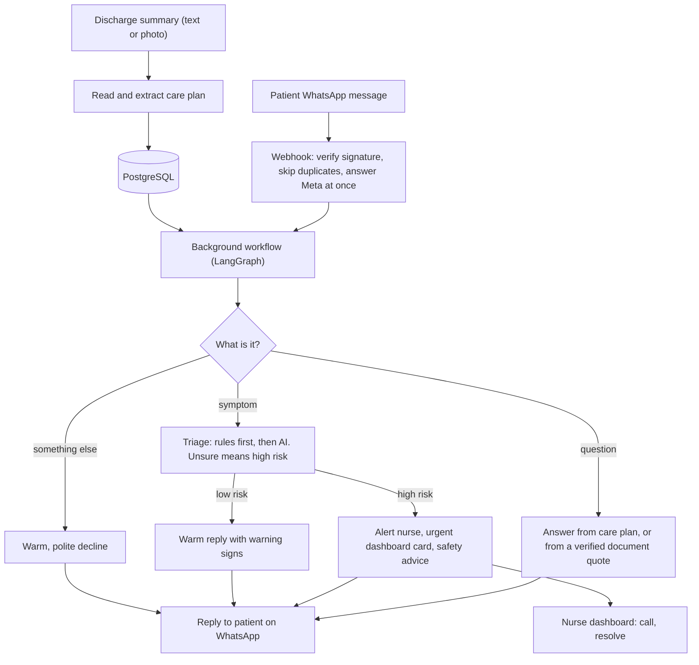

# Post-Discharge Patient Follow-Up Assistant

A WhatsApp assistant that helps care teams stay in touch with patients after they leave hospital. It answers recovery questions from the patient's own discharge summary, and it alerts a nurse when a message looks urgent.

> Demo only. It uses made-up data, it is not medical advice, and it has not been clinically validated.

**Demo video:** [coming soon ] &nbsp;|&nbsp; **Screenshots:** see the `docs/` folder

## The problem

Hospitals lose track of patients once they go home. Patients are left with a page of medical terms and a lot of questions: "Can I eat this?", "Is this pain normal?", "Do I keep taking my medicine?". Nurses cannot answer every call, and they cannot easily tell which messages are urgent.

## What it does

- **Reads a discharge summary** (text or a photo) and turns it into a structured care plan: diagnosis, medicines, follow-up date, warning signs.
- **Answers patient questions on WhatsApp in plain language**, using only the patient's own document. Broad questions ("which medicines do I take?") are answered straight from the care plan. Specific questions must be backed by an exact quote from the document, and the code checks that the quote really exists.
- **Triages symptoms.** Fast keyword rules run first. If they find nothing, an AI check decides, and when it is unsure it chooses *high risk*. Urgent cases alert the nurse and appear on a dashboard.
- **Gives nurses a dashboard** with urgent and low-priority cases, one-click call, and resolve.
- **Fails safely.** If processing breaks, the message still reaches a nurse and the patient still gets a safe reply.

## How it works

## Design decisions

- **A workflow, not a swarm of free agents.** In healthcare I want predictable, auditable paths. The AI is used where it helps (reading documents, understanding messages), and fixed rules and checks sit around it.
- **Verify the AI, do not trust it.** Answers need an exact quote from the document, checked in code. A made-up quote is rejected.
- **Rules first, AI second, bias toward caution.** A missed urgent message is far worse than an extra alert.
- **Only symptoms page a nurse.** Early versions alerted on every unanswered question, which floods a nurse queue (alert fatigue). Now questions are answered or politely declined, and only high-risk symptoms alert.
- **Answer Meta first, work second.** The webhook replies instantly and does the slow work in the background. Every WhatsApp message ID is claimed in the database first, so Meta's retries never cause double replies or double alerts.
- **All patient-facing wording lives in one file** (`graph/replies.py`) so a nurse can review it without reading code. It aims for plain language and short sentences, and it never tells a patient to stop a medicine.

## Safety and privacy

- Messages, care plans, diagnoses and full phone numbers are never written to logs. Phone numbers are masked, and WhatsApp message IDs (which hide the number) are hashed.
- The Meta webhook verifies the `X-Hub-Signature-256` signature, so fake messages are rejected.
- The dashboard and intake page need an admin login, and everything shown on the dashboard is HTML-escaped.
- Push alerts carry no symptom text.
- Use made-up data only.

## Tests

Run `python -m pytest`. The tests cover the security checks, duplicate handling, the fail-safe path, log cleanliness, intake validation, the Resolve button, and the wording and readability of every patient reply. Each important protection was also checked by deliberately breaking it and confirming a test failed.

A test run once exposed a real bug: the symptom-triage function had been overwritten by an unrelated edit, so urgent messages silently got no alert. It was found by testing, restored, and is now covered.

The `eval/` folder holds 43 labeled patient messages in English, Urdu and Roman Urdu, for measuring triage behaviour. The labels are a first draft and still need clinician review.

## Tech stack

Python, FastAPI, LangGraph, PostgreSQL (Neon), WhatsApp Cloud API, Groq-hosted open models (provider is configurable), Pushover alerts, Docker, Render (free tier), pytest.

## Run it locally

1. `python -m venv venv`, activate it, then `pip install -r requirements.txt`
2. Copy `.env.example` to `.env` and fill it in (see below).
3. `uvicorn webhook:app --reload --port 8000`
4. Expose it with a tunnel and set the callback URL in Meta to `https://<your-address>/meta/webhook`.
5. Open `/intake` (admin login), register a made-up patient, then message the WhatsApp number.

Docker: `docker build -t post-discharge-assistant .`

| Setting | Purpose |
|---|---|
| `DATABASE_URL` | PostgreSQL connection |
| `ADMIN_USER`, `ADMIN_PASSWORD` | Dashboard and intake login |
| `META_APP_SECRET`, `META_VERIFY_TOKEN` | Webhook signature and handshake |
| `META_WHATSAPP_TOKEN`, `META_PHONE_NUMBER_ID` | Sending WhatsApp replies |
| `LOG_HASH_SECRET` | Keyed hash for log references |
| `LLM_PROVIDER` and its API key | Which AI provider to use |
| `PUSHOVER_APP_TOKEN`, `PUSHOVER_USER_KEY` | Optional nurse push alerts |

## Hosting on free tiers: what to expect

It runs on free services (Render and Neon), which have real limits:

- The free web service sleeps after about 15 minutes without traffic, and the first request afterwards can take around 50 seconds. A free uptime ping on `/health` keeps it awake.
- Meta's test WhatsApp number can only message a handful of phone numbers that are added by hand. A public launch needs a verified business number.
- Meta's temporary token expires every 24 hours, so a system-user token is used for the live service.
- Messages that the business starts, outside WhatsApp's 24-hour reply window, need approved templates and can cost money.

## Known limitations

- Replies are in English only. Urdu and Roman Urdu messages are understood only partly.
- The general-guidance file is a placeholder and needs nurse-written content.
- Reply wording is a careful draft that a clinician should review.
- No per-nurse accounts or audit trail. The Resolve button leaves no record and has no protection against forged clicks.
- Extraction can vary between runs, and the assistant has not been clinically evaluated.
- Voice notes and photos are not read. The patient is asked to type.
- It is a single-hospital pilot design.

## What real users taught me

I talked to a real post-surgery patient, and her questions exposed gaps: mixed messages (a question plus a symptom), questions about stopping medicines, test results and worry, and the feeling of "talking to a wall". I also read an AI-assisted summary of public nursing material, which is a source of hypotheses, not verified interviews. Both shaped the roadmap below.

## Roadmap

1. A planner that splits mixed messages, remembers the conversation, and uses tools with the safety rules as guardrails.
2. Approve-or-reject flow: the assistant drafts, a nurse approves or edits.
3. A nurse-written response library for common worries and questions.
4. Urdu and Roman Urdu replies, then voice notes.
5. A scoring script for the labeled cases, with recall on urgent messages first.
6. A Telegram channel, per-nurse accounts, and an audit trail.

## Repository map

`webhook.py` (API, dashboard, intake), `security.py`, `safe_logging.py`, `storage.py`, `messaging.py`, `pushover_notify.py`, `scheduler.py` (daily check-ins, not started yet), `general_guidance.py`, `graph/` (workflow: `build`, `nodes`, `extraction`, `intent`, `triage`, `answering`, `replies`, `llm_provider`, `schemas`, `state`), `eval/` (labeled cases), `test_*.py`, `Dockerfile`.

Built with AI coding assistants. The design decisions, safety rules, testing and review are mine.